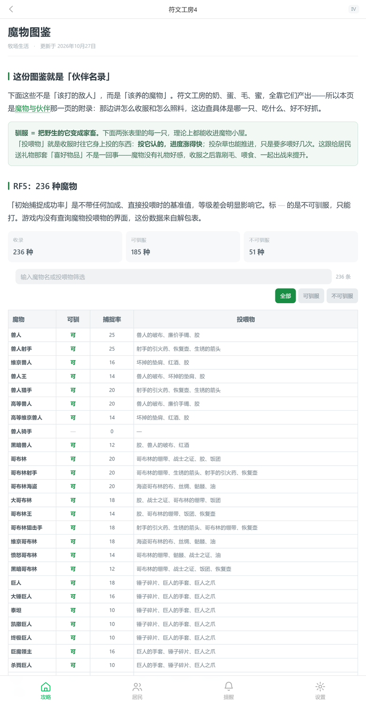

# 符文工房攻略百科（Rune Factory Wiki · 中文）

一个纯静态、可离线运行的符文工房（ルーンファクトリー / Rune Factory）系列中文资料站。

结构参考 [mineraltown.net](https://wiki.mineraltown.net/setting) 的栏目划分与版式风格，
数据则来自各作原始表格的整理与校对，**每部作品的物品、魔物、作物、钓点数据互相独立**，
不混用通用表。

**在线地址**：<https://jay110.github.io/rf-wiki/>　（GitHub Pages，随 `main` 分支自动构建）



## 特性

- 纯静态：无 CDN、无构建步骤、无后端，双击 `index.html` 即可运行
- Hash 路由单页应用：`#/` 是站点主页，`#/wiki` 是攻略目录，`#/page/<页面key>` 是具体条目
  （主页与攻略目录分开，结构参照矿石镇的攻略百科）
- 移动端优先：430px 宽度下表格横向滚动，不压成竖排
- 全站搜索：不只搜页面标题——当前作品四千多行数据表里的每个条目名都建了索引，
  输入即出建议，点结果跳到该页并高亮那一行（同名条目自动合并，多词搜不到时退回首词）
- 人物名册：7 部作品 199 人，每位带生日、声优、四档送礼喜好与回礼；
  可按「结婚候补／居民」筛选，也能一键按生日排出春夏秋冬的顺序，
  人名与礼物名都进了全站搜索（搜「金刚花」能翻出谁最喜欢它）
- 数据驱动：新增一部作品只需追加一个 `js/xxxdata.js`

## 本地运行

直接双击 `index.html`。若浏览器限制 `file://` 下的资源加载，可起一个本地服务：

```bash
python -m http.server 8000
# 然后访问 http://localhost:8000
```

## 目录结构

```
index.html          入口（脚本加载顺序在此定义）
css/main.css        布局、导航、主题
css/content.css     正文组件：表格、区块、分节
js/app.js           路由、渲染、搜索
js/pages.js         全部页面的结构定义与正文（最大文件）
js/icons.js         内联 SVG 图标

js/data.js          系列作品一览
js/items.js         RF1–RF4 物品
js/items4.js        RF4 物品补充
js/monsters.js      魔物总表
js/mon4.js          RF4 魔物
js/monrfo.js        RFO 魔物
js/resist.js        属性抗性
js/resist4.js       RF4 属性抗性
js/recipes.js       配方
js/fish.js          鱼类资料
js/fishspot.js      RF5 钓点
js/fishspot4.js     RF4 钓点
js/npcfull.js       人物档案（7 部作品 199 人：生日 / 声优 / 喜好 / 回礼）
js/npcdata.js       村民喜好（RF4 / RF5，解包表横向统计用）
js/cropdata.js      RF4 作物
js/rf1data.js       RF1 数据
js/rf2data.js       RF2 数据
js/rf3data.js       RF3 数据
js/rffdata.js       RFF 数据
js/extradata.js     扩展数据

_build_*.py         数据构建脚本（从源表格生成 js/*.js，非运行时依赖）
_xlsx_read.py       零依赖 xlsx 解析器
```

## 数据说明

`js/*.js` 中的数据文件均由 `_build_*.py` 从原始表格脚本化生成，构建脚本一并保留，
便于日后校对与增量更新。构建脚本依赖 Python 3.9+，不需要第三方库。

人物档案（`js/npcfull.js`）由 `_build_npcfull.py` 从
[biligame 符文工厂 wiki](https://wiki.biligame.com/runefactory/) 的
`RF1characters`～`RFOcharacters` 七个页面解析而来，原站内容以 CC BY-SA 授权，
本站在此基础上做了译名统一、按日文名对齐与字段清洗。原始 wikitext 抓取件留在本地 `_npc_src/`（不入库，需要时用 API 重抓即可）。

## 版权

本站为非官方粉丝向资料站，游戏名称与相关素材版权归 Marvelous Inc. / はしもとよしふみ 所有。
站内数据为手工整理与校对，仅供学习交流。
